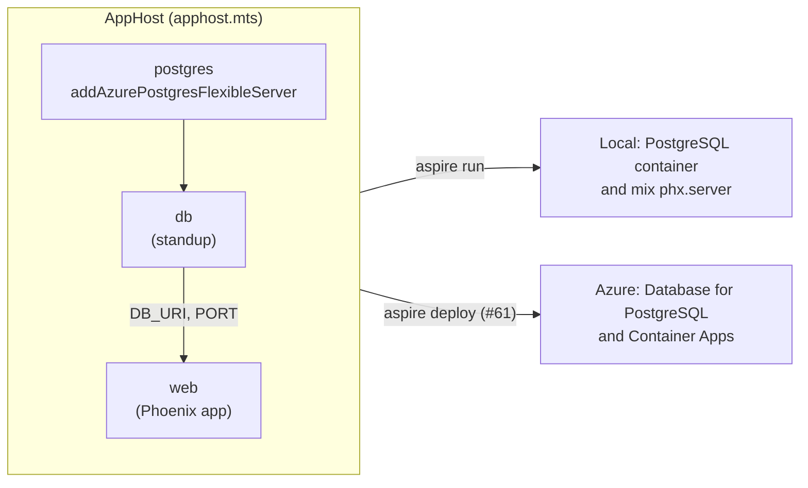

# Use an Aspire TypeScript AppHost for local orchestration and Azure provisioning

## Context and Problem Statement

Naked Standup is made of several parts that must run together: the Phoenix web
app, a PostgreSQL database, and, over time, other services such as Keycloak.
Developers need a single command that starts all of them locally with working
connections between them. The product is hosted on Microsoft Azure, so the same
description of the application should also provision the Azure resources and
deploy to them (Azure Container Apps, Azure Container Registry, and Azure
Database for PostgreSQL).

How should the product describe its parts, run them locally, and provision them
in Azure?

## Decision Drivers

* One definition of the application should be used for local development and
  for Azure, so the two do not drift apart.
* Local development should use a PostgreSQL container, and Azure should use
  Azure Database for PostgreSQL, without changes to the application code.
* The web app is written in Elixir, so the tool must be able to run a
  non-.NET application, and it must not require .NET code in the repository.
* The repository already uses TypeScript and pnpm for browser code.
* Running the application locally should show logs, health, and connection
  details in one place.
* The tool must be able to run in GitHub Actions to provision and deploy.

## Considered Options

* Aspire with a TypeScript AppHost
* Aspire with a C# AppHost
* Docker Compose for local development and Bicep for Azure
* Terraform for Azure, with Docker Compose for local development

## Decision Outcome

Chosen option: "Aspire with a TypeScript AppHost", because [Aspire](https://aspire.dev)
describes the application once and can both run it locally and provision and
deploy it to Azure, and a TypeScript AppHost keeps the repository free of .NET
project files while using a language the repository already has.

The AppHost is in `src/apphost` (`apphost.mts`), with the Aspire SDK pinned in
`aspire.config.json`. It is built in stages:

* **Local development (issue [#59](https://github.com/mfcollins3/standup/issues/59)).**
  `aspire run` starts a PostgreSQL container with a data volume, creates the
  `standup` database, and runs the Phoenix app with `mix` from source so that
  code reloading and the Vite watcher continue to work. Aspire generates the
  database credentials and gives the web app its connection details as
  environment variables. `config/runtime.exs` reads `DB_URI` for Ecto and `PORT`
  for the HTTP port.
* **Azure (issue [#61](https://github.com/mfcollins3/standup/issues/61)).** The
  same AppHost defines Azure Database for PostgreSQL, an Azure Container Apps
  environment, and an Azure Container Registry, and deploys the container image
  that is built and published by GitHub Actions.

The database is declared once as an Azure PostgreSQL resource and run as a
container locally with `runAsContainer()`, so the application code sees the same
resource and the same environment variables in both places.

### Consequences

* Good, because one command starts the whole application locally, and the
  Aspire dashboard shows each resource's state, logs, and connection details.
* Good, because the local and Azure environments are described by the same
  code, and the web app only needs to read `DB_URI`.
* Good, because the AppHost has no .NET project files and uses TypeScript, as
  the rest of the repository does.
* Bad, because TypeScript AppHosts have less complete support than C# AppHosts.
  The Aspire documentation notes that some strongly typed Azure Container Apps
  settings, such as scale and ingress rules, are C#-only, so those must be set
  another way (for example with Bicep overrides).
* Bad, because the Aspire CLI installs the AppHost's dependencies with
  `pnpm install --ignore-workspace`. That ignores `pnpm-workspace.yaml`, which
  is where pnpm 12 reads the approval of dependency build scripts, so the
  install fails for `esbuild` (a dependency of `tsx`, which Aspire uses to run
  the AppHost) unless the `pnpm_config_allow_builds` environment variable is set.
  It is the only setting that was found to work. It is set in continuous
  integration and documented in `src/apphost/README.md`, and this decision
  should be revisited if Aspire or pnpm changes this behavior.
* Bad, because Aspire is a newer tool than the alternatives, and the CLI and
  the generated TypeScript SDK (`.aspire/`) are tied to a specific Aspire
  version that must be upgraded together.
* Bad, because running the AppHost requires the Aspire CLI and a container
  runtime in addition to Elixir and Node.js.

### Confirmation

* The continuous integration workflow regenerates the Aspire SDK with
  `aspire restore` and lints and type-checks `apphost.mts` for every pull
  request.
* Starting the AppHost with `aspire run` shows the `postgres`, `db`, and `web`
  resources healthy, and the web app responding.
* Code review checks that connection details reach the application through
  environment variables from the AppHost, and not through values that are
  hard-coded for one environment.

## Pros and Cons of the Options

### Aspire with a TypeScript AppHost

* Good, because it combines local orchestration, a dashboard, and Azure
  provisioning and deployment in one tool.
* Good, because it can run non-.NET applications, such as the Elixir web app.
* Neutral, because the TypeScript SDK is generated by the Aspire CLI and is not
  committed.
* Bad, because of the gaps and the pnpm limitation described above.

### Aspire with a C# AppHost

* Good, because C# AppHosts have the most complete integration support and the
  strongest typing, including Azure Container Apps settings.
* Neutral, because the choice of language does not change what Aspire does.
* Bad, because it adds a .NET project, or a file-based C# AppHost, to a
  repository whose other code is Elixir and TypeScript, and the .NET SDK has to
  be used to build it.

### Docker Compose for local development and Bicep for Azure

* Good, because Docker Compose is widely known and has no extra CLI.
* Good, because Bicep is the native language of Azure resources.
* Bad, because the local and Azure environments are described twice, in two
  languages, and have to be kept consistent by hand.
* Bad, because there is no dashboard, and the web app would run in a container
  locally rather than from source, which makes code reloading harder.

### Terraform for Azure, with Docker Compose for local development

* Good, because Terraform is a mature tool and works across clouds.
* Bad, because it has the same duplication as Docker Compose with Bicep, and
  adds the Terraform state to manage.
* Bad, because the product is hosted only on Azure, so the cloud-neutral
  advantage is not needed.

## More Information

* Issue [#59](https://github.com/mfcollins3/standup/issues/59) implements local
  development and issue [#61](https://github.com/mfcollins3/standup/issues/61)
  implements Azure provisioning and deployment.
* The AppHost's documentation is in `src/apphost/README.md`.
* The container image that the AppHost deploys is described in the ADR for
  build-once container delivery (issue
  [#60](https://github.com/mfcollins3/standup/issues/60)).
* Revisit this decision if the TypeScript AppHost cannot express something that
  the Azure deployment needs, in which case a C# AppHost or Bicep overrides
  should be considered.
