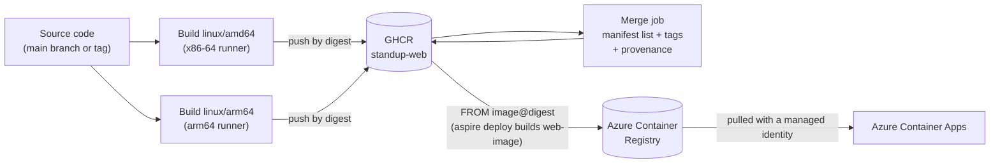

# Build the container image once and deliver it from GHCR to Azure Container Registry

## Context and Problem Statement

The web app is deployed to Azure Container Apps as a container image that
contains a Mix release. The image has to be built somewhere, stored in a
registry, and made available to Azure. The image should also run on the machines
that developers use, which include Apple silicon (arm64) laptops, as well as on
amd64 machines.

Where should the image be built and stored, how should it reach Azure Container
Registry (ACR), and how do we make sure that the image that is deployed is the
same image that was built and tested?

## Decision Drivers

* The bits that are deployed to Azure should be exactly the bits that CI built,
  not a second build of the same source.
* The image should support both `linux/amd64` and `linux/arm64`.
* Builds should be fast. Compiling Elixir and building the assets under
  emulation is slow, and dependencies should be cached.
* The image should be distributed from GitHub Packages (GHCR), next to the
  source code, so it can be pulled without an Azure account.
* The Azure deployment is a manual step (see issue
  [#61](https://github.com/mfcollins3/standup/issues/61)), so building the image
  must not depend on the deployment.
* The Container App must run an image from the Azure Container Registry that
  Aspire provisions, and must be able to pull from it without stored
  credentials.
* The build should record where the image came from (provenance).

## Considered Options

* Build once in GitHub Actions, publish to GHCR, and have Aspire deploy a
  one-line `FROM` image that is pushed to ACR
* Build once in GitHub Actions, publish to GHCR, and import the image into ACR
  with `az acr import`
* Build once in GitHub Actions and push to both GHCR and ACR
* Let Aspire build a second image from the source during deployment
* Build both platforms in one job with emulation (QEMU)

## Decision Outcome

Chosen option: "Build once in GitHub Actions, publish to GHCR, and have Aspire
deploy a one-line `FROM` image that is pushed to ACR", because it builds the
application image once, deploys exactly the layers that were published, and is
the only way that was found to get Aspire to push the image to ACR and give the
Container App access to pull it from there.

The decision has these parts:

* **Native builds per architecture.** The workflow
  `.github/workflows/container.yml` builds `linux/amd64` on an x86-64 runner and
  `linux/arm64` on an arm64 runner. Nothing is emulated. Each build pushes its
  image by digest.
* **One multi-platform image.** A final job combines the two digests into a
  manifest list and tags it `sha-<commit>`, the branch name, the version for
  `v*.*.*` tags, and `latest` for the default branch. Each platform pulls its own
  image from that one tag.
* **Cached builds.** Each architecture caches its Docker layers in the GitHub
  Actions cache. The Dockerfile orders its layers so that the dependency
  installation only repeats when `mix.lock` or `pnpm-lock.yaml` changes, and
  keeps the pnpm store in a BuildKit cache mount.
* **GHCR is the distribution registry.** The image is published as
  `ghcr.io/<owner>/standup-web`, and an
  `org.opencontainers.image.source` label links the package to the repository.
  The package is public.
* **Provenance.** The final job records a build provenance attestation for the
  published image. Per-platform attestations are disabled, because they would
  make the combined image an index of indexes. The deployment workflow verifies
  the attestation before it deploys.
* **Deploy a `FROM` image.** The AppHost declares the web app as an image that
  Aspire builds from `src/apphost/web-image/Dockerfile`, which only says
  `FROM ghcr.io/<owner>/standup-web@sha256:<digest>`. The deployment workflow
  resolves a tag to that digest. `aspire deploy` builds the image, pushes it to
  the ACR that it provisions, and deploys the Container App with a managed
  identity that has the `AcrPull` role.

### Consequences

* Good, because the layers that run in Azure are the layers that were built and
  attested in CI. The `FROM` image is pinned to the digest that was verified.
* Good, because Aspire handles the registry: it pushes the image and configures
  the Container App's registry and pull identity, so the deployment needs no
  registry credentials and no extra steps.
* Good, because builds are native and cached, so they are not slowed down by
  emulation.
* Good, because anyone can pull the image from GHCR to run the app locally on
  either architecture.
* Good, because building the image does not need Azure credentials, and the
  deployment can be run later, or repeated, for any published image.
* Bad, because the image in ACR is built by Aspire, so its manifest digest is
  not the digest of the image in GHCR. In the first deployment, the ACR image
  had the manifest digest `sha256:6253c179…`, and the published `linux/amd64`
  image has `sha256:ee23f3d9…`. The content is identical: both have the image
  configuration `sha256:17d39921…` and the same six layers, and a local build of
  the `FROM` image from the published arm64 image also had the same image ID and
  layer digests. The deployed content can be checked against the published image
  through its configuration digest, or through the `FROM` line.
* Bad, because `aspire deploy` builds on the deployment runner, which therefore
  needs Docker and has to pull the image from GHCR. It builds for the runner's
  platform only, which is `linux/amd64`.
* Bad, because the image is stored in two registries, GHCR and ACR, which costs
  some extra storage.
* Bad, because two builds run for every change, which uses twice the runner
  minutes of a single-platform build.
* Bad, because the Dockerfile repeats the Elixir, Erlang, Node.js and pnpm
  versions that are also in `.tool-versions` and `package.json`, and they have to
  be kept in sync.
* Bad, because the container runs the database migrations when it starts. That
  is fine for one replica. If the app is scaled out, the migrations should move
  to a separate Azure Container Apps job.

### Confirmation

* The container workflow builds both platforms for every pull request that
  changes the web app, so a broken Dockerfile is found before it is merged.
* After a merge to the main branch, `docker buildx imagetools inspect
  ghcr.io/<owner>/standup-web:latest` lists both `linux/amd64` and
  `linux/arm64`.
* The Bicep that Aspire generates for the Container App has a `registries`
  entry with the registry's login server and the pull identity. It does not for
  an image that Aspire did not build, which is why this option was chosen over
  importing the image.
* The deployment workflow verifies the image's attestation, and ends by
  checking that the deployed app answers `GET /healthz`.

## Pros and Cons of the Options

### Build once in GitHub Actions, publish to GHCR, and have Aspire deploy a one-line `FROM` image that is pushed to ACR

* Good, because Aspire pushes the image and sets up the pull access itself.
* Good, because the layers are exactly the published ones.
* Neutral, because the one-line Dockerfile is a small file to maintain.
* Bad, because the manifest digest in ACR differs from the one in GHCR, and
  because of the build on the deployment runner, as described above.

### Build once in GitHub Actions, publish to GHCR, and import the image into ACR with `az acr import`

* Good, because the image would have the same digest in both registries, as a
  multi-platform image.
* Bad, because Aspire does not configure the Container App's registry or pull
  identity for an image that it did not build. The generated Bicep for such an
  image has no `registries` entry, so the Container App could not pull from a
  private registry. This was found by reading the Bicep that `aspire publish`
  generates, and the TypeScript API cannot add it.

### Build once in GitHub Actions and push to both GHCR and ACR

* Good, because the image reaches ACR without an import step.
* Bad, because the build needs Azure credentials and an existing ACR, which does
  not exist until the Azure resources are provisioned. The first deployment
  needs a separate bootstrap.
* Bad, because it has the same missing pull configuration as the import option.

### Let Aspire build a second image from the source during deployment

* Good, because it is the simplest deployment: Aspire builds and pushes the image
  itself.
* Bad, because the deployed image is a second build of the source, not the image
  that was published, and it is built for one platform only.
* Bad, because the build runs again at deployment time, outside the cached
  workflow.

### Build both platforms in one job with emulation (QEMU)

* Good, because it needs one runner and one job.
* Bad, because compiling Elixir and building the assets under emulation is much
  slower than building natively.

## More Information

* Issue [#60](https://github.com/mfcollins3/standup/issues/60) implemented the
  Dockerfile, the release, and the workflow that publishes the image. Issue
  [#61](https://github.com/mfcollins3/standup/issues/61) implements the
  deployment, and is where the import option was found not to work.
* The image is built from `src/web/Dockerfile`. It runs as a non-root user,
  listens on port 8080, and answers `GET /healthz` for the health probes.
* The deployment is described in `docs/contributing/deployment.md`.
* The web app's architecture decision is in
  [the web app ADR](draft-web-app-phoenix-with-phoenix-vite-and-react.md), and
  the Aspire decision is in
  [the Aspire ADR](draft-aspire-typescript-apphost-for-orchestration-and-provisioning.md).
* Revisit this decision if Aspire can configure registry access for an image
  that it did not build, in which case importing the image would keep the
  digest, or if the app needs a separate migration step, or if images need to be
  signed or scanned before they are deployed.
