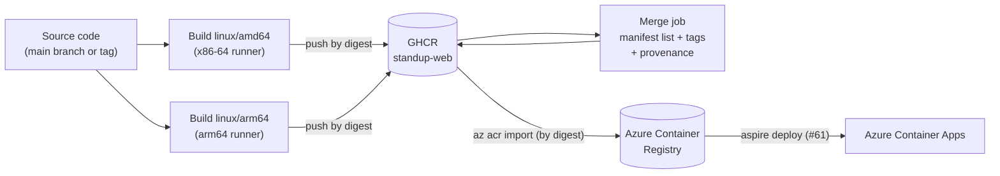

# Build the container image once and deliver it from GHCR to Azure Container Registry

## Context and Problem Statement

The web app is deployed to Azure Container Apps as a container image that
contains a Mix release. The image has to be built somewhere, stored in a
registry, and made available to Azure. The image should also run on the machines
that developers use, which include Apple silicon (arm64) laptops, as well as on
amd64 machines.

Where should the image be built and stored, how should it reach Azure Container
Registry (ACR), and how do we make sure that the image that is deployed is the
same image that was built and tested?

## Decision Drivers

* The bits that are deployed to Azure should be exactly the bits that CI built,
  not a second build of the same source.
* The image should support both `linux/amd64` and `linux/arm64`.
* Builds should be fast. Compiling Elixir and building the assets under
  emulation is slow, and dependencies should be cached.
* The image should be distributed from GitHub Packages (GHCR), next to the
  source code, so it can be pulled without an Azure account.
* The Azure deployment is a manual step (see issue
  [#61](https://github.com/mfcollins3/standup/issues/61)), so building the image
  must not depend on the deployment.
* The build should record where the image came from (provenance).

## Considered Options

* Build once in GitHub Actions, publish to GHCR, and import the image into ACR
  at deployment time
* Build once in GitHub Actions and push to both GHCR and ACR
* Let Aspire build a second image for ACR during deployment
* Build both platforms in one job with emulation (QEMU)

## Decision Outcome

Chosen option: "Build once in GitHub Actions, publish to GHCR, and import the
image into ACR at deployment time", because it builds the image once, so the
deployed image is the one that was published, and it keeps the build
independent of Azure.

The decision has these parts:

* **Native builds per architecture.** The workflow
  `.github/workflows/container.yml` builds `linux/amd64` on an x86-64 runner and
  `linux/arm64` on an arm64 runner. Nothing is emulated. Each build pushes its
  image by digest.
* **One multi-platform image.** A final job combines the two digests into a
  manifest list and tags it `sha-<commit>`, the branch name, the version for
  `v*.*.*` tags, and `latest` for the default branch. Each platform pulls its own
  image from that one tag.
* **Cached builds.** Each architecture caches its Docker layers in the GitHub
  Actions cache. The Dockerfile orders its layers so that the dependency
  installation only repeats when `mix.lock` or `pnpm-lock.yaml` changes, and
  keeps the pnpm store in a BuildKit cache mount.
* **GHCR is the distribution registry.** The image is published as
  `ghcr.io/<owner>/standup-web`, and an
  `org.opencontainers.image.source` label links the package to the repository.
* **Import into ACR, don't rebuild.** The deployment workflow (issue
  [#61](https://github.com/mfcollins3/standup/issues/61)) copies the image
  from GHCR into the ACR that Aspire provisions, with `az acr import` and by
  digest. Aspire deploys that image and does not build one.
* **Provenance.** The final job records a build provenance attestation for the
  published image. Per-platform attestations are disabled, because they would
  make the combined image an index of indexes.

### Consequences

* Good, because the image that runs in Azure has the same digest as the image in
  GHCR, so what was built is what is deployed.
* Good, because builds are native and cached, so they are not slowed down by
  emulation.
* Good, because anyone can pull the image from GHCR to run the app locally on
  either architecture.
* Good, because building the image does not need Azure credentials, and the
  deployment can be run later, or repeated, for any published image.
* Bad, because the deployment workflow needs to read from GHCR to import the
  image, which needs a token if the package is private.
* Bad, because the image is stored in two registries, GHCR and ACR, which costs
  some extra storage.
* Bad, because two builds run for every change, which uses twice the runner
  minutes of a single-platform build.
* Bad, because the Dockerfile repeats the Elixir, Erlang, Node.js and pnpm
  versions that are also in `.tool-versions` and `package.json`, and they have to
  be kept in sync.
* Bad, because the container runs the database migrations when it starts. That
  is fine for one replica. If the app is scaled out, the migrations should move
  to a separate Azure Container Apps job.

### Confirmation

* The container workflow builds both platforms for every pull request that
  changes the web app, so a broken Dockerfile is found before it is merged.
* After a merge to the main branch, `docker buildx imagetools inspect
  ghcr.io/<owner>/standup-web:latest` lists both `linux/amd64` and
  `linux/arm64`.
* The deployment workflow (issue
  [#61](https://github.com/mfcollins3/standup/issues/61)) checks that the image
  digest in ACR matches the digest in GHCR.

## Pros and Cons of the Options

### Build once in GitHub Actions, publish to GHCR, and import the image into ACR at deployment time

* Good, because of the single build and the same digest everywhere.
* Good, because the build and the deployment are independent.
* Bad, because of the extra import step and the second copy of the image.

### Build once in GitHub Actions and push to both GHCR and ACR

* Good, because the image reaches ACR without an import step.
* Bad, because the build needs Azure credentials and an existing ACR, which does
  not exist until the Azure resources are provisioned. The first deployment
  needs a separate bootstrap.
* Bad, because every build writes to ACR, even for images that are never
  deployed.

### Let Aspire build a second image for ACR during deployment

* Good, because it is the simplest deployment: Aspire builds and pushes the image
  itself.
* Bad, because the deployed image is a second build of the source, not the image
  that was published, and it is built for one platform only.
* Bad, because the build runs again at deployment time, outside the cached
  workflow.

### Build both platforms in one job with emulation (QEMU)

* Good, because it needs one runner and one job.
* Bad, because compiling Elixir and building the assets under emulation is much
  slower than building natively.

## More Information

* Issue [#60](https://github.com/mfcollins3/standup/issues/60) implements the
  Dockerfile, the release, and the workflow. Issue
  [#61](https://github.com/mfcollins3/standup/issues/61) implements the import
  into ACR and the deployment, and has to confirm that Azure Container Apps can
  pull an imported image with the registry's managed identity.
* The image is built from `src/web/Dockerfile`. It runs as a non-root user,
  listens on port 8080, and answers `GET /healthz` for the health probes.
* The web app's architecture decision is in
  [the web app ADR](draft-web-app-phoenix-with-phoenix-vite-and-react.md), and
  the Aspire decision is in
  [the Aspire ADR](draft-aspire-typescript-apphost-for-orchestration-and-provisioning.md).
* Revisit this decision if the app needs a separate migration step, or if images
  need to be signed or scanned before they are deployed.
