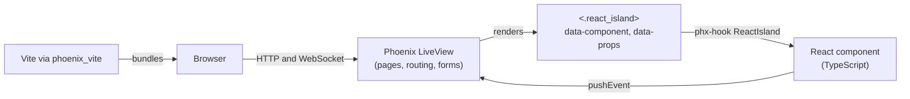

# Build the web app with Phoenix LiveView, phoenix_vite and React islands

## Context and Problem Statement

Naked Standup needs a web application that runs in the latest versions of
Google Chrome, Microsoft Edge, and Apple Safari. Most of the web app is
conventional: sign-in, workspaces and projects, the standup feed, settings,
and billing. One part is not conventional. Recording a status report uses the
browser media APIs (`getUserMedia` and `MediaRecorder`), which need a rich,
stateful client-side component with a live camera preview (see NS-010).

The Product Requirements Document (PRD) does not choose a web technology stack.
Which stack should the web application use, and how should the media recording
code be built within it?

## Decision Drivers

* The author is already productive with Elixir and Phoenix, and wants one
  language and one runtime for the server.
* Most screens are forms and lists that are well served by server-rendered
  HTML with live updates.
* The recorder needs client-side state and the browser media APIs, and its
  logic needs to be unit-tested without a server.
* The web app must meet WCAG 2.2 AA, so semantic HTML and keyboard support
  matter more than visual effects.
* Product features such as the public REST API are separate from the web app,
  so the web app does not have to be a single-page application (SPA) that
  consumes that API.
* The build should be simple and fast to run in development and in the
  container build.

## Considered Options

* Phoenix LiveView with React islands, bundled by phoenix_vite
* A React single-page application built with Vite and a separate API
* Next.js (React with server rendering)
* Blazor (.NET)

## Decision Outcome

Chosen option: "Phoenix LiveView with React islands, bundled by
phoenix_vite", because it keeps the application in one Phoenix project, uses
server-rendered LiveView for the many ordinary screens, and still allows
rich client-side components written in React and TypeScript where the browser
APIs require them.

The application is created in `src/web` as the OTP application `:standup`.
The decision has these parts:

* **LiveView for pages.** Pages, routing, forms, and live updates use Phoenix
  LiveView. Authentication will integrate with Keycloak through OpenID Connect
  when it is built.
* **phoenix_vite replaces esbuild.** [phoenix_vite](https://hex.pm/packages/phoenix_vite)
  connects Vite to Phoenix, including the development server with hot module
  replacement and the production manifest. Tailwind CSS and daisyUI come from
  the Phoenix generator and are bundled by Vite.
* **React islands for rich components.** A React component is registered by
  name and mounted from a LiveView hook with the `<.react_island>` function
  component. The server passes props as JSON, and the component sends events
  back with `pushEvent`. React owns only the island's DOM, so the rest of the
  page stays server-rendered.
* **TypeScript for all browser code.** Browser code is written in TypeScript
  with strict checking, and unit-tested with Vitest and Testing Library.
* **pnpm manages JavaScript dependencies.** The phoenix_vite installer supports
  only npm and bun, so the generated project is converted to pnpm and a small
  `Standup.Pnpm` module runs `pnpm` as the Vite watcher.

### Consequences

* Good, because most screens need no client-side JavaScript beyond LiveView,
  and the server stays the source of truth for application state.
* Good, because the recorder can use React state and TypeScript types, and be
  tested with Vitest independent of Phoenix.
* Good, because Vite provides fast hot reloading for both Elixir templates and
  React components during development.
* Good, because the web app, its tests, and its container build live in one
  project.
* Bad, because phoenix_vite does not provide React support, so the Fast
  Refresh preamble and the island hook are maintained in this project.
* Bad, because the Vite plugins are pinned by compatibility. phoenix_vite
  targets Vite 6 and 7, so `@vitejs/plugin-react` is held at version 5, which
  supports those versions, rather than version 6, which requires Vite 8.
* Bad, because phoenix_vite supports npm and bun but not pnpm, so a small
  amount of glue code is needed, and must be kept when phoenix_vite is
  upgraded.
* Bad, because there are two languages and two test suites to maintain
  (Elixir and TypeScript).

### Confirmation

* `mix precommit`, the TypeScript type check, and both test suites run in the
  continuous integration workflow (`.github/workflows/ci.yml`) for every pull
  request.
* Code review checks that new rich client components are registered in
  `assets/js/components/index.ts` and mounted with `<.react_island>`, rather
  than using a separate bundle or a single-page application shell.

## Pros and Cons of the Options

### Phoenix LiveView with React islands, bundled by phoenix_vite

* Good, because it combines server-rendered pages with client-side components
  only where they are needed.
* Good, because one deployable serves the whole web app.
* Neutral, because React islands are a convention in this project and are not
  a feature of Phoenix or phoenix_vite.
* Bad, because it requires custom hook code and a pnpm adapter, as described
  above.

### A React single-page application built with Vite and a separate API

* Good, because the app uses the public REST API in the same way as customers
  do.
* Good, because the client-side tooling is the most conventional.
* Bad, because every screen becomes a client-rendered React screen, and the
  server API must cover everything the web app does before the web app can
  work.
* Bad, because it requires a second deployable for the API or static hosting,
  plus authentication and routing on the client.

### Next.js (React with server rendering)

* Good, because it provides server rendering, routing, and React in one
  framework.
* Neutral, because its server rendering would help with public share pages,
  which Phoenix can also render.
* Bad, because it adds a second server-side language and runtime, the Node.js
  server, next to the Elixir services.

### Blazor (.NET)

* Good, because C# could be used for the whole stack and it fits Azure
  hosting well.
* Bad, because the media APIs (`getUserMedia` and `MediaRecorder`) would
  require JavaScript interop code anyway.
* Bad, because it is not the language and framework that the author works
  with day to day.

## More Information

* Issue [#58](https://github.com/mfcollins3/standup/issues/58) implements this
  decision, and issue [#57](https://github.com/mfcollins3/standup/issues/57)
  is the first feature built on it.
* The island hook is in `src/web/assets/js/hooks/react_island.tsx` and the
  server-side component is in
  `src/web/lib/standup_web/components/react_components.ex`.
* Revisit this decision if phoenix_vite stops being maintained, or if the
  amount of client-side code grows to the point where most screens are React
  components.
